  

  

### 🙋 Sobre mí

- 🎓 Ingeniería en Informática – Instituto Profesional Santo Tomás (práctica profesional finalizada, en proceso de titulación)
- 🔭 Trabajando en **SimATC**, tráfico IA con ATC propio para MSFS 2024
- 🎮 Me gustan los videojuegos, la simulación y automatizar cosas
- 📫 Conéctate conmigo:

### 🛠️ Tecnologías

  
  
  
  
  

### 🚀 Proyectos

  
  
  
  

### 📊 Estadísticas

  
  

